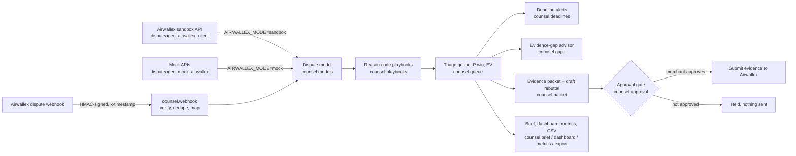

# Chargeback Counsel (Airwallex hackathon, Track 4)
One-command showcase: `./scripts/showcase.sh` (demo video script in DEMO_SCRIPT.md). Run demo: `python3 -m disputeagent.agent`   Test: `python3 -m pytest -q`
- `disputeagent/mock_airwallex.py` — mocked Airwallex-like APIs (swap for sandbox client)
- `disputeagent/agent.py` — triage -> evidence -> score -> EV decision -> packet -> approval gate -> submit
Env: `AUTO_SUBMIT_LIMIT` (default 500). LLM hook: `llm_narrative()`.

## counsel/ package (reason-code playbooks + approval gate)
An approval-gated agent that handles card disputes for SMB merchants on Airwallex: it scores each dispute
against reason-code playbooks, drafts an evidence-backed rebuttal, and never submits without the merchant's approval.
Built for the Airwallex Agentic Banking Hackathon (2026).

Status (Oct 27 2026): dispute model, five reason-code playbooks with win-likelihood scoring, rebuttal drafter,
human-approval gate, 10 synthetic disputes, signed webhook ingestion, ranked EV triage queue, evidence-deadline alerts,
evidence-gap checks, per-currency recovery metrics, end-to-end merchant brief, and a static HTML dashboard.
Demo video: `python3 scripts/make_demo_video.py` builds a narrated 92-second walkthrough at `data/demo/chargeback_counsel_demo.mp4`.

Next: live Airwallex sandbox calls (build window opened Oct 27).

```
python3 -m counsel.seed   # writes data/disputes.json
python3 -m counsel.queue  # ranked triage queue: P(win), expected value, contest/accept
python3 -m counsel.deadlines --today 2026-11-01  # contest-worthy disputes near or past evidence due date
python3 -m counsel.dashboard --today 2026-11-08  # static HTML dashboard -> data/dashboard.html
python3 -m counsel.packet  # one approval-gated evidence packet per dispute -> data/packets/
python3 -m counsel.brief --today 2026-11-08 --out data/brief_late.md  # end-to-end merchant brief (deadlines first, approval-gated)
WEBHOOK_SECRET=dev python3 -m counsel.webhook --port 8085  # signed dispute webhook receiver
python3 -m pytest -q
```

## Architecture



The sandbox path is dashed because live sandbox calls are still waiting on Airwallex sandbox API keys; every demo and test runs on the mock backend.
